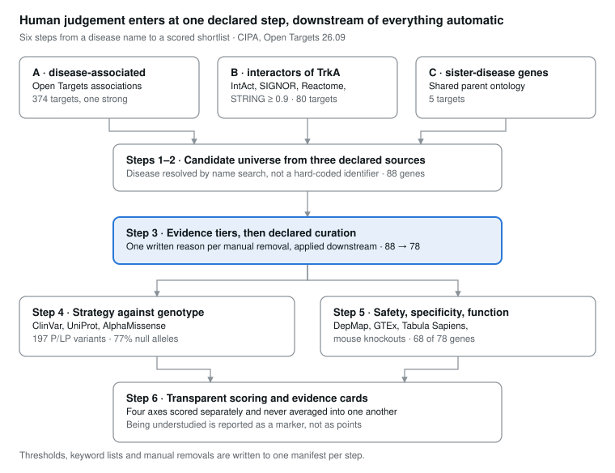

# rare-target-prioritization

**A reproducible pipeline that proposes and ranks therapeutic targets for a rare monogenic disease, and says plainly what it cannot know.**

Demonstrated on **CIPA** — congenital insensitivity to pain with anhidrosis, also called hereditary sensory and autonomic neuropathy type 4 (MONDO_0009746) — caused by biallelic loss-of-function variants in *NTRK1*, which encodes the NGF receptor TrkA. There is no disease-modifying therapy.

Built entirely on public resources: Open Targets, Pharos/IDG, ClinVar, UniProt, AlphaFold DB (AlphaMissense), GTEx and Tabula Sapiens via Open Targets, and mouse knockout phenotypes.



**No experimental validation of any kind.** This is a prioritised list of hypotheses from public data — not clinical guidance, and not a validated result. The *Limitations* section at the bottom is the part worth reading first.

A step-by-step account of the method, the errors found along the way, and the open questions is in **[docs/walkthrough.md](docs/walkthrough.md)**. Data provenance and licences are in **[DATA_SOURCES.md](DATA_SOURCES.md)**.

---

## The question

Given a rare monogenic disease, which genes are plausible starting points for a therapy — and which of them are *understudied*, in the sense the Illuminating the Druggable Genome programme gives the term?

The honest answer turned out to be more interesting than a ranking, and the three findings below are the point of the repository.

---

## Three findings

**1. The pipeline recovers the ground truth it was never told.**
The six genes known to cause congenital insensitivity to pain in humans — *NTRK1*, *NGF*, *SCN9A*, *SCN11A*, *PRDM12*, *ZFHX2* — are exactly the six whose mouse knockouts show nociception phenotypes, and they sit at the top of the ranking. Mouse phenotype data enters the pipeline independently of the genetics, so this is a positive control rather than a restatement. (Partially: see *Limitations*.)

**2. The only genuinely dark candidates are dark partly because the right tissue was never measured.**
Of 78 curated candidates, only **PRDM12** and **ZFHX2** fall in the understudied-and-unliganded quadrant. Both are nociceptor transcription factors. Both are also the candidates whose tissue specificity cannot be assessed, because neither GTEx nor Tabula Sapiens samples the dorsal root ganglion. *PRDM12* peaks at 0.52 TPM across all 50 GTEx tissues. The gap in the atlases and the gap in the literature point at the same missing tissue.

**3. The best-supported targets serve the fewest patients.**
Of 197 pathogenic / likely pathogenic *NTRK1* variants in ClinVar, **77% are null** and a further 13% are kinase-domain missense: roughly nine in ten leave no functional TrkA kinase. Strategies that act *through* TrkA — supplying ligand, raising expression, transactivating the receptor — can therefore serve only a few per cent of variants, yet they score highest, because they are the ones with ligands, phenotypes and chemical matter behind them. The broadly applicable route, restoring *NTRK1* itself, is a single entry with little to score.

This tension is reported, not resolved. A ranking that hid it would be a worse result.

---

## How it works

Five phases, each writing a dated snapshot and a manifest recording every declared threshold.

### Phase 1 — Disease → genes
The disease is resolved by **name search**, not a hard-coded identifier, so the pipeline transfers to another disease unchanged. All associated targets are retrieved with their evidence broken down by type.

> 374 associated targets. Only *NTRK1* scores strongly (0.86) with genetic evidence; the rest is a long tail of mouse-phenotype similarity, literature co-mention and symptomatic-drug targets.

### Phase 2 — A candidate universe from three declared sources
A disease-association list in a monogenic disease contains one cause and a weak tail, so two further sources are added:

| source | definition | result |
|---|---|---|
| **A** disease-associated | Phase 1, weighted by evidence type | 374 |
| **B** mechanistic neighbours | direct interactors of the causal gene (IntAct, SIGNOR, Reactome, STRING ≥ 0.9) | 80 |
| **C** sister-disease genes | causal genes of diseases sharing a parent ontology class | 5 |

Each gene keeps the source it came from. Sources A and B barely overlap: the disease-association list does not contain the TrkA signalling machinery.

### Phase 2b/2c — Evidence tiers, declared curation, the opportunity map
Candidates are tiered by evidence quality (curated interaction vs STRING-only; genetic/clinical vs background). Genetic evidence within 1 Mb of the causal gene is flagged as possibly positional — this correctly caught *INSRR* and *SH2D2A*, both adjacent to *NTRK1* at 1q23.

Manual judgements live in **one declared block with one written reason each**, separate from the automatic steps and applied on top of them, so their effect stays visible and reversible: partners of oncogenic *NTRK1* fusions (*TPM3*, *TPR*, *TFG*), ligands of unrelated receptor tyrosine kinases linked only by STRING, and a minimum genetic score for A-only genes. Pool: 88 → **78**.

The **opportunity map** separates two things the exam criterion conflated: how *studied* a target is (Pharos novelty) and how much *chemical matter* exists for it. "No known drug" and "poorly understood" are different axes.

### Phase 3 — Which strategy fits which genotype
ClinVar variants for the causal gene, restricted to one reference transcript, classified as null / missense / in-frame and mapped onto protein regions from UniProt. AlphaMissense scores every possible substitution.

- Reference-residue check: **100%** of missense variants match the UniProt sequence.
- AlphaMissense agrees with ClinVar on **30/32** pathogenic and **22/22** benign missense variants — and flags **83 of 397** variants of uncertain significance as likely pathogenic, a prioritised list for future reclassification, not a reclassification.
- Per-residue intolerance is far higher in the kinase domain (0.70) than extracellular (0.38), which corrects a claim made in the 2025 exam write-up.

A declared table then maps each allele group to the strategies that could serve it.

### Phase 3b — What kind of edit would revert each variant
Read from HGVS notation only: 31% transitions (within reach of base editing in principle), 24% transversions, 41% small indels, 3% large. **No single variant dominates**, so per-variant correction needs a guide per variant while gene addition is one construct for every genotype. Because the disease is recessive and carriers are unaffected, restoring one of two alleles may be enough.

### Phase 4 / 4b — Safety, specificity, and function
Essentiality (DepMap via Open Targets), cancer role, known safety liabilities, baseline expression, and **mouse knockout phenotypes** as the one orthogonal, functional axis available without an experiment.

Tissue specificity is read as **agreement between two resources that ask different questions** — bulk GTEx asks whether a gene concentrates in nervous *tissue*, single-cell data asks whether it concentrates in neural *cell types*. Their disagreement is informative:

- **both** — the signal survives either framing;
- **single-cell only** — a sparse, scattered cell type that bulk tissue dilutes away; for a sensory neuropathy this is the expected pattern, and it is where *NTRK1*, *NGF* and *SCN9A* land;
- **bulk only** — present in nervous tissue but perhaps not in neurons: a question, not a score;
- **not assessable** — below detection in the atlases available.

### Phase 5 — Transparent scoring, strategy, evidence cards
Four declared axes, scored separately and **never averaged into one another**: disease link (3) + tissue specificity (2) + safety (2) + mouse knockout (3). Being understudied is reported as a marker, not as points: it is an opportunity, not evidence.

Each candidate carries its therapeutic strategy, the **direction** the target would have to move — almost always *activate*, in a loss-of-function disease — and which variant groups that strategy could serve. Targets whose existing drugs are inhibitors are flagged: *SCN9A* has 79 clinical-stage molecules, all developed to block it for analgesia, which is precisely backwards here.

---

## Shortlist (top 10)

| gene | source | strategy | direction | score | note |
|---|---|---|---|---|---|
| SCN9A | C | restore excitability of surviving neurons | activate | 10 | excellent target, weakest strategy — see below |
| ZFHX2 | C | redirect nociceptor specification | activate | 10 | **Tdark**, no chemical matter |
| SCN11A | C | restore excitability of surviving neurons | activate | 10 | as SCN9A |
| NGF | C | raise signalling through TrkA | activate | 10 | serves ~4% of variants |
| NTRK1 | seed | restore NTRK1 itself | restore / replace | 8 | the only broadly applicable route |
| PRDM12 | C | redirect nociceptor specification | activate | 8 | understudied; specificity not assessable |
| KIDINS220 | B | re-engage the pathway below the receptor | activate | 8 | understudied |
| GDNF | B | recruit a parallel neurotrophic pathway | activate | 8 | does not use TrkA |
| NTF3 | B | raise signalling through TrkA | activate | 8 | understudied |
| NGFR | B | modulate the p75 co-receptor | **unclear** | 8 | direction must be established first |

**A route that emerged from the data, not from the starting hypothesis.** Three genes form a coherent group: *ADCYAP1* (PACAP), its receptor *ADCYAP1R1* (PAC1), and *ADORA2A*. The literature describes GPCR transactivation of TrkA through Src-family kinases — and *FYN* and *SRC* are both in the pool. *ADCYAP1R1* is neural-enriched in both resources and already has a chemical probe. *ADORA2A* knockout mice show an **increased thermal nociceptive threshold**, meaning the receptor normally promotes nociception, so activating it is the right direction — independent support from a different data type. The same pipeline also raises the objection: *ADORA2A* is "bulk only", consistent with a striatal receptor, so whether it is present on peripheral nociceptors at all remains open.

---

## 2025 vs 2026

This project began as an MSc exam in which candidate T-dark genes were selected by hand. The pipeline re-evaluates that selection.

- **Survive, with the right reasons:** *PRDM12*, via strong genetic evidence in a sister disease, and *NTF3*, as a genuine TrkA-pathway ligand.
- **Do not survive:** *AWAT2*, *FOXE3*, *LMX1B*, *MPV17* (mouse-phenotype similarity only), *SH2D2A* and *HAX1* (weak or positional genetic evidence), *SUCLA2* (no longer associated).
- **Why:** the 2025 criterion — no known drugs, no chemical probe, at most three tractability assessments — selects *undrugged* genes. Pharos Tdark selects *understudied* genes. All eight exam genes still associated are Tbio, none Tdark. The criterion was not wrong; it was measuring a different axis.

---

## Limitations

The parts worth reading before trusting anything above.

- **No experimental validation.** Every proposed experiment is a proposal. Agreement between two expression atlases is robustness to the choice of resource, not validation.
- **Neither atlas samples the dorsal root ganglion**, the tissue where this disease lives. GTEx here provides central nervous tissue but no peripheral nerve. The clearest symptom of this: *NTRK1* itself has prostate as its top GTEx tissue, while being 84-fold enriched in neural cell types at single-cell resolution.
- **The mouse axis is partly circular for source C.** Those genes entered because they cause sister diseases, so their pain phenotypes are not fully independent. The axis is genuinely new information for source B — *KIDINS220*, *RAB7A*, *NTF4*, *NGFR*, *GDNF*, *NTRK2*, *ADORA2A* — which entered on interaction evidence alone.
- **The score measures target quality, not strategy plausibility.** *SCN9A* and *SCN11A* score 10/10 as targets, but the strategy they imply presumes surviving nociceptors, and in CIPA those neurons largely never formed. This is why strategy and genotype coverage stay in separate columns from the total.
- **Variants are not patients.** Allele frequencies are not modelled; in founder populations a few variants cover a large share of chromosomes. Weighting by gnomAD frequency is the obvious next step.
- **The editing analysis is notation-level only** — no PAM sites, editing windows, guide design, off-target or efficiency assessment.
- **Restoring the sequence does not regenerate neurons already lost in development.** In mice lacking both TrkA and Bax, sensory neurons survive but fail to innervate their targets (Patel et al., *Neuron* 2000). Any downstream strategy must restore axon growth, not only survival.
- **Declared curation is judgement, not computation.** Every manual decision, threshold and keyword list is recorded in the phase manifests so it can be disagreed with precisely.

---

## Reproducing

The notebook runs top to bottom in Google Colab; no API key is needed. Each phase caches its API responses, so a restarted session resumes instead of re-querying.

```
notebooks/rare_target_prioritization.ipynb   the whole pipeline, run top to bottom
docs/walkthrough.md                          step-by-step account of the method
docs/pipeline.svg
data/processed/    tables + one manifest per phase (declared thresholds, versions)
figures/
DATA_SOURCES.md    what was retrieved, from where, under which licence
requirements.txt
```

`data/raw/` holds the cached API responses and is **not tracked** — it is large, regenerated on any run, and the manifests already record which resource release each snapshot came from. Create the directory and the notebook fills it.

To run it on a different disease, change `DISEASE_QUERY` in the first cell and revisit the declared curation blocks — the automatic steps transfer, the judgements do not.

**Data sources and versions** are recorded in the manifests. This run: Open Targets **26.09**; ClinVar retrieved via NCBI E-utilities; UniProt **P04629**; AlphaFold DB entry **AF-P04629-F1**; reference transcript **NM_002529.4**.

---

## Author

Simone Edoardo Candelo — MSc Biotechnologies and Applied Artificial Intelligence for Health, University of Pisa.
ORCID [0009-0000-5741-574X](https://orcid.org/0009-0000-5741-574X)
